# SmartMachines — Predictive Maintenance Intelligence

<div align="center">


**Plataforma de Manutenção Preditiva, Telemetria Industrial e Inteligência Operacional para a Indústria 4.0**  
*Desenvolvido no Hackathon Antigravity do SENAI Ourinhos no curso de Aplicações com IA Generativa.*

🚀 **Ambiente de Produção Online (Vercel):** [https://smartmachines-seven.vercel.app/](https://smartmachines-seven.vercel.app/)  
🐙 **Repositório GitHub:** [https://github.com/siteprofissional1/smartmachines](https://github.com/siteprofissional1/smartmachines)

[English Overview](#english-overview) • [Visão em Português](#visão-geral-pt-br) • [Arquitetura](#arquitetura-em-3-camadas) • [9 Pilares](#matriz-dos-9-pilares-do-hackathon) • [Roteiro de Demonstração](#roteiro-de-demonstração-pitch-flow) • [Instalação](#instalação-e-execução)

</div>

---

## English Overview

**SmartMachines** is an enterprise-grade Industry 4.0 predictive maintenance intelligence platform. It processes telemetry from 400 industrial machines across 5 automated production lines, continuously monitors physical indicators (vibration velocity, surface temperature, hydraulic pressure, electric current, acoustic noise), predicts equipment failure risk, correlates telemetry with spare part availability via public web scraping, and synthesizes engineering action plans powered by **Google Gemini 2.0 Flash** with real-time **Firebase Firestore** synchronization.

### Key Highlights
- **Deterministic vs. Probabilistic Separation:** Health scores and OEE metrics are calculated strictly via deterministic Python algorithms, while Gemini synthesizes root-cause hypotheses and actionable maintenance workflows.
- **Local RAG Retrieval:** Compact machine-specific context (< 1,000 tokens) prevents token bloat and hallucination.
- **Graceful Degradation:** Runs seamlessly in `CONNECTED`, `LOCAL DATA`, or `DEMO` mode without external dependencies breaking the UI.
- **Industrial Command Center UI:** Designed according to ISO 10816 standards, with dark mode default, responsive drawer inspections, and interactive Plotly.js charts.

---

## Visão Geral (PT-BR)

O **SmartMachines** transforma dados históricos e telemetria de sensores industriais em decisões preditivas acionáveis para equipes de manutenção, engenharia de confiabilidade (PCM) e suprimentos industriais.

### Desafios Resolvidos:
1. **Eliminação do Downtime Não Planejado:** Identificação de anomalias de vibração e temperatura antes do colapso mecânico.
2. **Conexão Realtime com Suprimentos:** Scraper de cotações que monitora peças sobressalentes homologadas (SEW-Eurodrive, Siemens, SKF, WEG, FESTO), comparando custo histórico e preço de mercado.
3. **Pareceres Transparentes com IA:** Recomendações mecânicas fundamentadas em evidências físicas e limites normativos.

---

## Arquitetura em 3 Camadas Antigravity

```mermaid
flowchart LR
    CSV[data_smartmachines_manutencao.csv] --> DataAgent[Data Agent\nETL & RAG]
    DataAgent --> RiskAgent[Risk Agent\nHealth Score]
    RiskAgent --> ScraperAgent[Scraper Agent\nCotações & Cache]
    ScraperAgent --> MaintenanceAgent[Maintenance Agent\nContexto Compacto]
    MaintenanceAgent --> Gemini[Google Gemini\n2.0 Flash]
    Gemini --> Firestore[Cloud Firestore\nNoSQL Realtime]
    Firestore --> Dashboard[Dashboard React\nonSnapshot Listeners]
    Dashboard --> User[Operador / Engenheiro PCM]
```



### 1. Camada 1 — Diretivas & Estratégia (`/directives`)
- Regras de negócio, contratos de dados, design system industrial e Procedimentos Operacionais Padrão (SOPs 01 a 08).
- Política de **Self-Annealing** documental que atualiza os SOPs quando novas restrições técnicas são identificadas.

### 2. Camada 2 — Orquestração & Inteligência (`/agents`)
- Agentes especializados em Python: `DataAgent`, `RiskAgent`, `ScraperAgent`, `MaintenanceAgent` e `Orchestrator` CLI.
- Isolamento absoluto de credenciais: o Gemini executa apenas no pipeline seguro e nunca expõe chaves no navegador.

### 3. Camada 3 — Execução Determinística (`/scripts`, `/src`)
- Ingestão com pandas, geração de snapshots estáticos, persistência no Firestore e interface reativa em React 18 + Vite + Plotly.js.

---

## Matriz dos 9 Pilares do Hackathon

| Pilar | Implementação Técnica | Arquivos Chave | Demonstração no Sistema |
|---|---|---|---|
| **1. Engenharia & Diretivas** | Arquitetura de 3 Camadas, SOPs padronizados e política documental Self-Annealing | `directives/projeto.md`, `directives/SOP/*.md` | Documentação técnica completa na pasta `directives/` |
| **2. UI/UX & Design System** | Industrial Command Center com Dark Mode (#070B11), Light Mode, tokens e drawer móvel | `directives/design/design.md`, `src/styles/theme.css` | Alternador de tema no cabeçalho e layout responsivo em celulares |
| **3. Base RAG & Mineração** | Ingestão de 1.200 leituras, 400 máquinas, validação de schema e RAG local (< 1.000 tokens) | `data/data_smartmachines_manutencao.csv`, `agents/data_agent.py` | Execução via `python -m agents.orchestrator machine EQP-0215` |
| **4. Web Scraping & Dados Vivos** | Scraper de peças industriais com cache local (`parts_prices.json`) e fallback LIVE/CACHED | `scraper/parts_scraper.py`, `agents/scraper_agent.py` | Tela **Parts & Quotes** com spread de preço e status do fornecedor |
| **5. Multi-Agentes & Gemini** | Orquestração de agentes com System Prompt rigoroso e saída em JSON estruturado | `agents/orchestrator.py`, `agents/maintenance_agent.py` | Aba **AI Insights** e parecer preditivo na inspeção do equipamento |
| **6. Banco Realtime NoSQL** | Google Cloud Firestore com batch writes e listeners `onSnapshot` sem recarregar a tela | `scripts/seed_firestore.py`, `src/services/firebase.ts` | Indicador `Firebase: CONNECTED` no cabeçalho e sincronização ativa |
| **7. Governança & Segurança** | Zero credenciais no bundle do cliente, `.env.example` sem segredos e regras no Firestore | `firestore.rules`, `.gitignore`, `utils/env_helper.py` | Auditoria de segurança aprovada e variáveis protegidas |
| **8. CI/CD & Deploy em Nuvem** | Workflows automatizados de build, testes e deploy estático para GitHub Pages | `.github/workflows/deploy-pages.yml`, `sync-intelligence.yml` | Pipeline de Integração Contínua e execução via GitHub Actions |
| **9. Analytics & Visualizações** | 6 gráficos analíticos interativos com Plotly.js (Donut, Scatter Vibração x Temp, Histograma) | `src/components/Charts/*.tsx`, `src/pages/OverviewPage.tsx` | Gráficos com tooltips dinâmicos e identificação de outliers |

---

## Roteiro de Demonstração (Pitch Flow — 3 a 5 Minutos)

1. **Cena 1 — Overview Global:** Apresente o dashboard com 400 máquinas monitoradas, Plant Health Score de 73.8% e os 4 KPIs de topo.
2. **Cena 2 — Identificação do Risco:** Destaque o gráfico Donut de estados operacionais e o gráfico de dispersão Vibração ($X$) vs Temperatura ($Y$), apontando os pontos vermelhos que ultrapassam os limites normativos.
3. **Cena 3 — Banner "Attention Required":** Mostre o card da máquina crítica `EQP-0215` (ou `EQP-0176`) no topo da tela inicial.
4. **Cena 4 — Inspeção 360° (Gaveta Lateral):** Clique em **Inspecionar** para abrir o modal detalhado.
5. **Cena 5 — Telemetria & Confiabilidade:** Mostre os valores físicos em tempo real (Vibração 6.74 mm/s, Temperatura 92.4 °C, Horímetro e MTBF).
6. **Cena 6 — Suprimentos & Cotação Externa:** Aponte para a peça de reposição (Redutor Planetário SEW), mostrando o comparativo entre custo histórico de catálogo e cotação de mercado obtida pelo Scraper.
7. **Cena 7 — Parecer Preditivo do Gemini:** Compare o *Dataset Baseline Diagnosis* com o *Gemini 2.0 Flash Predictive AI & Plano de Ação* (hipóteses, sinais observados e janela de intervenção).
8. **Cena 8 — Simulação em Tempo Real:** No terminal, execute `python scripts/simulate_realtime.py EQP-0215 vibration` e veja o badge **`DEMO EVENT`** piscar em rosa no dashboard sem refresh!
9. **Cena 9 — Governança dos 9 Pilares:** Navegue até a aba **System** e demonstre a conformidade de 100% dos 9 pilares do edital.

---

## Instalação e Execução

### Pré-requisitos
- Node.js 18+ e npm
- Python 3.10+ com pip

### 1. Instalar Dependências
```bash
# Frontend
npm install

# Backend / Pipeline Python
pip install -r requirements.txt
```

### 2. Configurar Variáveis de Ambiente
Copie o arquivo de exemplo e configure suas credenciais:
```bash
cp .env.example .env
```
*(Nota: O SmartMachines funciona perfeitamente em modo `LOCAL DATA` mesmo sem chaves de API).*

### 3. Executar o Dashboard
```bash
npm run dev
```
Acesse em: `http://localhost:3000`

### 4. Executar os Agentes de Inteligência
```bash
# Diagnóstico completo de máquina via CLI
python -m agents.orchestrator machine EQP-0215

# Atualização de cotações externas
python -m agents.orchestrator quotes

# Pipeline completo
python -m agents.orchestrator all
```

### 5. Executar Testes
```bash
# Testes unitários do pipeline Python
python -m pytest tests/

# Validação estática de tipos TypeScript
npm run lint
```

---

## Estrutura do Projeto

```text
smartmachines/
├── .github/workflows/          # CI/CD: deploy no Pages e sync periódico
├── agents/                     # Multi-agentes Python (Data, Risk, Scraper, Maintenance, Orchestrator)
├── data/                       # Dataset original e processados
│   ├── data_smartmachines_manutencao.csv
│   ├── processed/              # dataset_summary.json
│   └── cache/                  # parts_prices.json (cache do scraper)
├── directives/                 # Camada 1: Diretivas, SOPs de 01 a 08 e design system
│   ├── design/                 # design.md, ideia-design.md, prompts
│   └── SOP/                    # SOPs técnicos específicos
├── documentation/              # promptHistory.md e documentações de entrega
├── public/data/                # Snapshots JSON otimizados para o frontend
├── scraper/                    # Módulo de Web Scraping e provedores de cotação
├── scripts/                    # Scripts determinísticos de análise, seed e simulação
├── src/                        # Código-fonte React + TypeScript
│   ├── components/             # Componentes modulares, gráficos Plotly e gavetas
│   ├── hooks/                  # Hooks reativos (useSmartMachinesData, useTheme)
│   ├── pages/                  # 7 Telas operacionais completas
│   ├── services/               # Firebase Web SDK e DataService
│   ├── styles/                 # theme.css com tokens de design
│   └── utils/                  # Formatadores e cálculos determinísticos
├── tests/                      # Suíte de testes automatizados pytest
├── executar.bat                # Menu rápido interativo para Windows
├── executar.ps1                # Runner de automação PowerShell
├── firestore.rules             # Regras de segurança NoSQL
├── requirements.txt            # Dependências Python
└── package.json                # Dependências Node.js
```

---

## Tecnologias e Frameworks Utilizados

- **Frontend:** React 18, Vite, TypeScript, Lucide Icons, Plotly.js, CSS Modern Tokens.
- **Backend & Pipeline:** Python 3.12, Pandas, BeautifulSoup4, Requests, Python-Dotenv.
- **Inteligência Artificial:** Google Gemini 2.0 Flash (SDK google-genai).
- **Banco de Dados Realtime:** Google Cloud Firestore NoSQL.
- **Governança & DevOps:** GitHub Actions, GitHub Pages, Pytest, Antigravity Framework.

---

<div align="center">
  desenvolvido por <a href="https://siteprofissional.pro" target="_blank" rel="noopener noreferrer" style="color: #3b82f6; text-decoration: underline; font-weight: bold;">siteprofissional</a>
</div>
